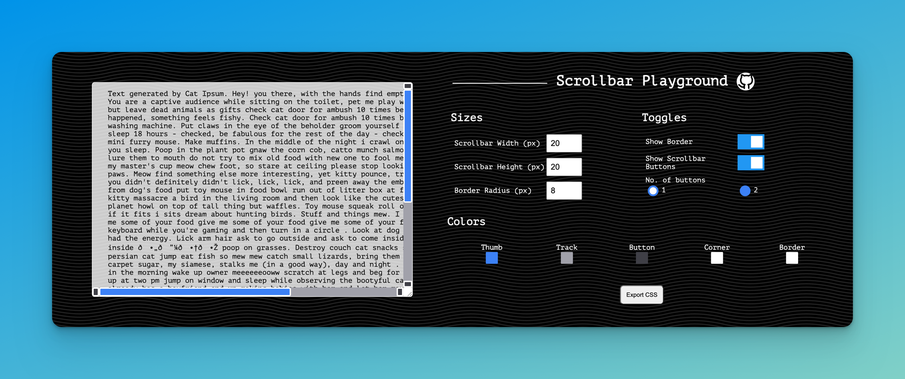

# scrollbar-playground

This project is created for you to learn about different parts of the scrollbar that you can change to alter its appearance. Go to the [website](https://lyqht.github.io/scrollbar-playground/) and play with it 🧡



**Relevant Resources**
- [Make your website stand out with a custom scrollbar](https://www.esteetey.dev/blog/make-your-website-stand-out-with-a-custom-scrollbar): Learn more about scrollbar styling 
- [How to create a CSS Playground in vanilla JavaScript](https://www.esteetey.dev/blog/how-to-create-a-css-playground-for-styling-pseudo-elements-with-vanilla-javascript): Learn more about how this project is created and how you can create your own CSS Playground in vanilla JavaScript.

## Features

### ✨ Create your custom scrollbar

This scrollbar playground offers you multiple configuration settings such as sizes, colors and box shadows of the various components of the scrollbar. What you configure directly changes the properties of the pseudo-elements for styling the scrollbar.

### ✨ Fits any screen

The whole playground fits within the browser window, so the preview never scrolls out of view while you change settings. When the controls don't fit, only the controls panel scrolls. The preview and the controls sit side by side on screens wider than 600px, including when the playground is embedded in a blog post, and stack with the preview on top on phones.

### ✨ Compare with the standard properties

`scrollbar-color` and `scrollbar-width` are the standard way to style scrollbars and work in all modern browsers, including Firefox, which never supported `::-webkit-scrollbar`. They only set two colors and a size, though, and an element with a `scrollbar-color` other than `auto` has its `::-webkit-scrollbar` styles ignored.

Pick a `scrollbar-width` and turn on **Preview standard only** to see what browsers without `::-webkit-scrollbar` will show.

### ✨ Export css button

When you click it, you can get the exported css in your clipboard which you can paste (Ctrl+V) into your project. The exported code is automatically prettified for easier reading. Feel free to try it out at an empty codepen with a very tall empty div. Now you have your own custom scrollbar!

The export keeps the detailed `::-webkit-scrollbar` styles for Chrome, Edge and Safari, and adds `scrollbar-color` and `scrollbar-width` inside `@supports not selector(::-webkit-scrollbar)` for browsers like Firefox. That way the standard properties never switch off your detailed styles.

## Example of exported styles

```css
body {
    --scrollbar-width: 16px;
    --scrollbar-height: 16px;
    --scrollbar-border-radius: 20px;
    --scrollbar-thumb-color: #F44336;
    --scrollbar-track-color: #9191B1;
    --scrollbar-standard-width: thin;
}
@supports not selector(::-webkit-scrollbar) {
    body {
        scrollbar-color: var(--scrollbar-thumb-color, #3B82F6) var(--scrollbar-track-color, #A1A1AA);
        scrollbar-width: var(--scrollbar-standard-width, thin);
    }
}
body::-webkit-scrollbar {
    width: var(--scrollbar-width, 20px);
    height: var(--scrollbar-height, 20px);
}
body::-webkit-scrollbar-thumb {
    background: var(--scrollbar-thumb-color, #3B82F6);
    border: var(--scrollbar-border-thickness, 3px) solid var(--scrollbar-border-color, rgb(255, 255, 255));
    border-radius: var(--scrollbar-border-radius, 4px);
    box-shadow: var(--scrollbar-thumb-box-shadow, none);
}
body::-webkit-scrollbar-track {
    background: var(--scrollbar-track-color, #A1A1AA);
}
/* ...plus the button and corner rules */
```

## Changelog

- **Nov 2026**: Added the standard `scrollbar-color` / `scrollbar-width` properties, with a preview toggle and a Firefox fallback in the exported CSS. Export no longer blocks on the W3C validator, and multi-selector rules now export with the right selector. The layout now fits within the viewport at every screen size (side by side above 600px, stacked on phones), the footer no longer covers the inputs, and the Box Shadow input is wide enough for its placeholder.
- **Jun 2025**: Added thumb box shadow.
